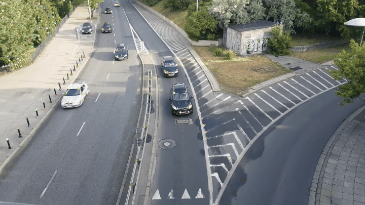
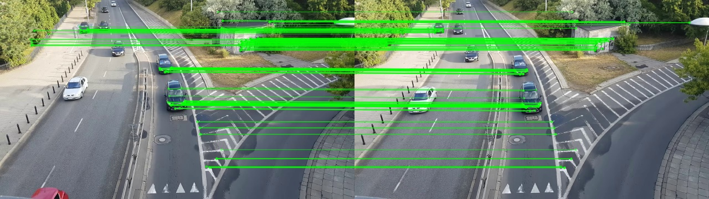

# Real-Time Vehicle Motion Tracking & Feature Matching

A classical computer vision pipeline implementing **Sparse Lucas-Kanade Optical Flow** for continuous vehicle trajectory tracking alongside **ORB Feature Detection and Geometric Matching** for correspondence analysis. Built entirely without deep learning dependencies.

---

## Deliverables & Visuals

| Optical Flow Tracking (`demo.gif`) | Feature Matching (`orb_matches.jpg`) |
| :---: | :---: |
|  |  |
| *Real-time Lucas-Kanade motion vectors over highway traffic* | *ORB cross-frame matching filtered via Lowe's ratio test & RANSAC* |

---

## Architectural Overview

The repository is modularized into two distinct scripts reflecting separate classical vision paradigms:

1. **`tracker.py` (Temporal Tracking)**: Implements differential optical flow to track smooth pixel motion frame-by-frame under brightness constancy.
2. **`matcher.py` (Wide-Baseline Correspondence)**: Extracts invariant keypoint descriptors and computes geometric homography across discrete frames.

---

## Pipeline & Technical Implementations

### 1. Optical Flow Pipeline (`tracker.py`)

* **Corner Detection (Shi-Tomasi):** Identifies trackable 2D features by solving the structure tensor $M = \sum W \begin{bmatrix} I_x^2 & I_x I_y \\ I_x I_y & I_y^2 \end{bmatrix}$ and scoring quality via $R = \min(\lambda_1, \lambda_2)$.
* **Multi-Scale Lucas-Kanade (`cv2.calcOpticalFlowPyrLK`):** Resolves large vehicle displacements across a 3-level Gaussian pyramid using coarse-to-fine iterative least-squares estimation.
* **Persistent Trajectory Visualization:** Uses a decoupled mask layer to render historical motion vectors with deterministic color assignments per tracked point.
* **Periodic Feature Refresh:** Periodically re-seeds corner coordinates every 40 frames (or when tracked points drop below 20) to handle track termination and newly entering vehicles.

### 2. Feature Matching Pipeline (`matcher.py`)

* **ORB (Oriented FAST and Rotated BRIEF):** Detects multi-scale corners using FAST and constructs 256-bit binary descriptors with rotation invariance computed via intensity centroids.
* **Hamming Distance Matching:** Matches binary descriptors using `cv2.BFMatcher(cv2.NORM_HAMMING)`.
* **Outlier Filtering (Lowe’s Ratio Test + RANSAC):** Discards ambiguous matches where $d_1 \ge 0.75 \cdot d_2$, followed by RANSAC homography estimation (`cv2.findHomography`) to reject geometric outliers.

---

## Parameter Rationales

| Parameter | Value | Engineering Rationale |
| :--- | :---: | :--- |
| `maxCorners` | `150` | Balances lane-wide spatial coverage against optical flow solver overhead, preventing point clustering while maintaining >30 FPS. |
| `qualityLevel` | `0.03` | Rejection threshold set to 3% of maximum corner response ($R_{\text{max}}$). Accommodates lower-contrast vehicle contours (windshields, bumpers) against dominant, high-contrast road markings. |
| `minDistance` | `10` | Non-Maximum Suppression (NMS) Euclidean radius ensuring keypoints distribute across multiple vehicles rather than bunching on a single high-contrast fixture (e.g., license plates). |
| `blockSize` | `7` | $7 \times 7$ integration window averaging spatial image gradients to suppress high-frequency asphalt texture and sensor grain. |
| `winSize` | `(15, 15)` | Local spatial window assuming uniform velocity; prevents boundary leakage between vehicle contours and the stationary road surface. |
| `maxLevel` | `2` | 3-level Gaussian pyramid enabling tracking of large inter-frame vehicle displacements (up to ~60 px) without violating the first-order Taylor series assumption. |

---

## Setup & Execution

### Prerequisites

```bash
pip install opencv-python numpy imageio